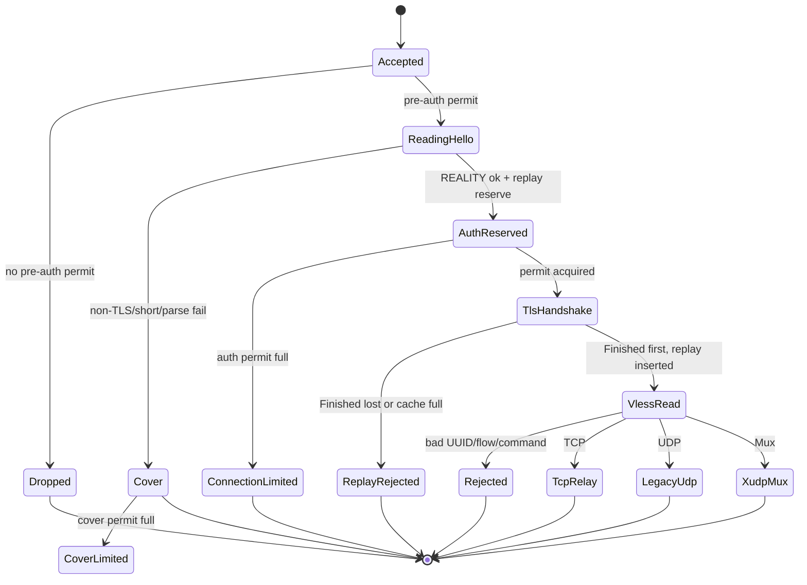

# Implicit state machines — audit and hardening plan

Read-only audit, 2026-11-11. No production code was changed by this audit; this
document is the deliverable. It inventories every stateful mechanism in the
server and the two client launchers, names the states and guards that are
currently implicit, records the defects that code review confirmed, and proposes
one decision for a follow-up implementation.

Nothing here is a wire-protocol change. Where a change would alter a timeout
policy or an admission bound, it is marked **policy**.

## In one page

- **What exists:** 21 lifecycle machines plus 11 supporting stateful
  mechanisms. The server carries implicit phases for process/accept, admission,
  replay, TLS records, Vision Direct, relay direction, XUDP mux/session/
  resolution/queue, legacy UDP, and config. The clients carry tray, DNS-file,
  and process-handle states.
- **What is explicit today:** `VisionReaderMode`, `VisionReaderAction`,
  `SessionStatus`, `SessionTable`, `CloseReason`, `MuxError`, `UdpError`,
  `ConnectionOutcome`, `IpLimitReject`, `RelayConfig`. These are outcomes and
  containers, not phases.
- **What is implicit:** booleans, `Option`s, counters, table membership, task
  presence, permit ownership, and filesystem/process presence. One logical
  state is typically spread over three to five such variables.
- **Confirmed defects:** seven (D1–D7) plus a
  documentation/observability bucket, listed in
  [Confirmed defect register](#confirmed-defect-register). All seven and the
  bucket are fixed in this tree, each with the regression test named in the
  register; no byte-level protocol change was made. The teardown gap recorded
  under D8e is closed as well: a guard now releases sessions, sockets, and
  permits when the handler is cancelled or panics.
- **Main structural risk:** a future edit updates one source of truth and misses
  another. Vision Direct needs four booleans, three watch channels, and five
  buffers to agree; an XUDP session is table membership plus `closed` +
  `failed` + `stop` + permit ownership.
- **Best decision:** one explicit lifecycle phase per long-lived object, owned
  by one task, changed by one transition function, emitted as one structured
  event. Keep wire format, limits, and fallback policy unchanged.

## Scope and method

- Rust server: `crates/beam`, `crates/beam-core`, `crates/beam-sys`.
- Clients: `clients/linux-tray` (GTK tray + setuid helper), `clients/windows-tray`.
- Deployment scripts are mentioned only where they own long-lived recovery
  state (`beam-dns-reset.service`, installer rollback).
- No live tunnel, soak, or benchmark was run. Every claim below is code and
  in-repo test evidence. Line numbers are for this checkout; symbol names are
  the durable anchor.
- [STRESS-FINDINGS.md](STRESS-FINDINGS.md) findings 10 and 12 remain open and
  are counted here, not re-litigated.

**Implicit state** here means behavior that depends on remembered mode or
history, has legal and illegal transitions, and has no single typed value a
reader or test can name. REALITY authentication itself is stateless per call
(`reality/auth.rs`) and is not a machine; the persistent state is the replay
cache.

## Inventory

Risk is about *diagnosability and change safety*, not about a known outage.
**P1** marks machines where one logical state is spread over several
independent variables.

|#|Machine|Kind|Where|Source of truth|
|---|---|---|---|---|
|1|Process / listener lifecycle **P1**|implicit|`crates/beam/src/main.rs:76,84,177,286,367,370`|locals in `async_main`, two signal streams, three permit counts|
|2|Accept backoff|implicit|`main.rs:307-327`|`accept_backoff`|
|3|Pre-auth + authenticated admission **P1**|mixed|`admission.rs:39-108`, `tls/server.rs:807-862`|`IpLimiter`, `Semaphore`, `Option<IpPermit>` ownership|
|4|Connection classification|explicit outcome, implicit path|`tls/server.rs:805-862`, `257-273`|`ClientHelloRead`, `Option<(Auth, ReplayReservation)>`, `ConnectionOutcome`|
|5|REALITY replay cache **P1**|explicit|`tls/server.rs` replay section|`ReplayPhase` + `states` + `deadlines`|
|6|TLS record stream + raw handoff **P1**|implicit|`tls/stream.rs:180-260,490-530`|`read_raw`, `write_raw`, `record`, `pending`, `plaintext`, `outgoing`, `pending_write`, `closed`|
|7|Cover relay|implicit|`tls/server.rs:1426-1461,1673-1713`|cover permit + first-half-close `select!`|
|8|Authenticated request pipeline|explicit command, implicit phases|`tls/server.rs:1253-1410`|absolute deadline + `match request.command`|
|9|Vision TLS detector|implicit|`vision/state.rs:72-257`|`filter_budget`, `is_tls`, `is_tls12_or_above`, `enable_xtls`, `pending_server_hello`|
|10|Vision writer|implicit|`vision/state.rs:454-660`|`first_block`, `padding_enabled`, `VisionWritePlan` flags|
|11|Vision reader|**explicit**|`vision/state.rs:665-780`|`VisionReaderMode::{Framed,Ended,Direct}`|
|12|Vision Direct handoff **P1**|implicit|`vision/stream.rs:56-82,178-260,351-410,433-560,626-808`|4 booleans + 3 watch channels + 5 buffers|
|13|Relay direction / activity **P1**|implicit|`relay/splice_copy.rs:228-275,440-560,826-832`|`Direction` flags + `RelayActivity`|
|14|XUDP mux lifecycle **P1**|implicit|`xudp/server.rs:593-697,790-1010`|`empty_since`, task handles, select arms|
|15|XUDP session lifecycle **P1**|implicit|`xudp/session.rs:841-958`, `xudp/server.rs:1158-1570`|table membership + `closed`/`failed`/`stop` + permit + reply task|
|16|Retained GlobalID reattachment|implicit|`xudp/session.rs:913-1010`, `xudp/server.rs:1224-1300,1496-1560`|`expiring` map + `expires_at`|
|17|XUDP resolution generations|implicit|`xudp/server.rs:199-460`|`pending` map + `generation` + owner/suffix|
|18|Reply/send queue admission|implicit|`xudp/session.rs:106-127,652-720`, `xudp/server.rs:1015-1108,1591-1628`|`SlotGuard` + mpsc capacity + 2 byte semaphores|
|19|Legacy UDP / packetaddr|implicit|`udp/legacy.rs:259-303,897-990`|split stream + decoder cursor + destination set + idle sleep|
|20|Config validation / derived budgets|implicit|`config/validate.rs:177-260`, `main.rs:102-105,445-518`|`Raw*` → `Config` → derived configs|
|21|Client try / DNS helper / Windows supervision|implicit|`clients/linux-tray/tray.c:76-160`, `helper.c:126-280`, `clients/windows-tray/main.c:169-345`|C globals, file presence, process handle|

Supporting stateful mechanisms (not separate lifecycle machines):

|ID|Mechanism|Where|Why it is stateful|
|---|---|---|---|
|S1|ClientHello assembly|`tls/server.rs:865-890,963-1122`|header/body/fast-complete buffers; partial or extra bytes become `Forward`|
|S2|VLESS request streaming parse|`tls/server.rs:1472-1512`, `vless/header.rs`|fixed header buffer, retry on `is_truncated`, then body handoff|
|S3|Metrics counters|`metrics.rs:13-43,95-252`|monotonic atomics, snapshot only|
|S4|`PrependStream`|`prepend_stream.rs`|prefix cursor before passthrough|
|S5|`ReplayStream`|`tls/server.rs:726-794`|replays the pre-read prefix, then the socket|
|S6|`RecordRead`|`tls/stream.rs:686-803`|header/body fill and readiness|
|S7|`FrameDecoder`|`udp/legacy.rs:924-990`|need-header/need-payload/has-frame cursor|
|S8|`DestinationTable`|`udp/legacy.rs:897-923`|admit/new/reject set|
|S9|`SlotGuard` / `ReplyQueueBudget`|`xudp/session.rs:106-127,652-720`|counted permits with RAII release|
|S10|`RelayStopGuard`|`tls/server.rs:2129-2155`|armed/disarmed sibling-stop guard|
|S11|`IpPermit`|`admission.rs:92-108`|held/released per-IP + global permit|

## Top-level connection lifecycle

Key ordering (`tls/server.rs:805-862`): read ClientHello → parse → REALITY
authenticate → replay reserve → authenticated permit → *then* drop pre-auth →
TLS handshake → replay insert (first wins) → VLESS read → UUID/flow checks →
command dispatch. Reservation rejection forwards the original wire bytes to the
cover; a post-`Finished` replay rejection closes. This ordering avoids an
authentication oracle, but it is not a rule that *every* pre-auth failure goes
to the cover: an empty `Forward` prefix closes without a cover dial, and some
authenticated failures close without cover.

## Per-machine detail

### 1. Process / listener lifecycle (P1)

**States.** Starting (parse, validate, build TLS config, bind) → Running
(accept loop) → Draining → Stopped.

- Config load `main.rs:84-97`; fd-budget check `102-105`; `--check` builds the
  runtime config and returns `123-130`; runtime state `132-180`; listener
  `177`; metrics task `193`; signals `286-294`; accept loop `307`.
- Shutdown: `drop(listener)` `367`, then wait while any authenticated, pre-auth,
  or cover permit is outstanding (`370-372`), bounded by `shutdown_drain_ms`;
  `main` then bounds runtime shutdown at 3 s (`76-82`).
- SIGHUP is logged and ignored (`286-294`); only SIGTERM/SIGINT drain.

**Guards / edges.** Accept errors are counted and backed off, never fatal
(`318-327`). New work stops after the listener drop, but already-accepted tasks
can still authenticate, dial, start a cover relay, and open XUDP/legacy
sessions — there is no shared draining flag that forbids those transitions.
Blocking splice tasks cannot be aborted; the 3 s runtime shutdown is the final
backstop.

**Drain observation window (D8d, fixed).** The drain loop only looks at three
permit counts. On the `None` arm of `match auth` in
`handle_connection_admitted` the pre-auth permit used to be dropped *before*
`forward_to_cover` acquired the cover permit, so another thread could observe
all three counts at zero inside that window and a cover relay could start
concurrently with drain completion. `forward_to_cover` now takes
`preauth: Option<IpPermit>` and drops it only after `cover_limiter.try_acquire`
succeeds (`tls/server.rs`); the only path that releases pre-auth without a cover
permit is the `CoverLimited` rejection, which starts no relay. The invariant is
therefore "no cover relay starts after the pre-auth release without a cover
permit held", pinned by
`cover_forward_releases_the_preauth_permit_on_failure`. Authenticated
connections never had this window: they acquire the authenticated permit before
dropping pre-auth.

**Why implicit.** No `ProcessPhase`; the phase is inferred from listener
existence, which loops are running, and three permit counts.

**Observability.** `runtime counters` / `runtime pressure counters`
(`main.rs:203-283`); no phase field.

**Tests.** `tests/stress/loopback.py` exercises SIGTERM, the drain deadline,
exit status, and socket closure under a full pre-auth pool. No unit test covers
this boundary.

### 2. Accept backoff

One `Duration`: 10 ms after success, doubling on error to 1 s (`main.rs:307-325`).
An interrupted accept is treated as an ordinary error and backs off. No test
references `accept_backoff`, so the exact sequence is unpinned. The invariant is
"a transient accept error never drops the listener".

### 3. Pre-auth and authenticated admission (P1)

**States.** Unheld → pre-auth global+per-IP held → released at classification;
separately unheld → authenticated permit held for the whole session. Cover has
its own `IpLimiter` (32 global / 8 per source) held through the relay.

- `preauth.try_acquire(peer.ip())` `main.rs:333-343`; rejection records
  `preauth_rejected` and drops the socket. The permit moves into the task.
- Authenticated permit: `try_acquire_owned` `tls/server.rs:847`; rejection
  records `connection_limited` and returns `ConnectionLimited` without cover
  fallback. Pre-auth is dropped only after the permit is acquired (`855`).

**Illegal / edge.** Pre-auth bounds handshakes, not data path:
`max_pending_handshakes = clamp(max_connections, 16, 256)`, and
`max_preauth_per_ip = min(configured, pending)` (`main.rs:136-145`). Cover is
bounded separately so a scanner cannot consume authenticated capacity.

**Why implicit.** Phase is permit ownership. `IpLimiter` canonicalizes IPv4 to
match a dual-stack listener (`admission.rs:52-54`) and drops the per-IP entry
when the last permit is released.

**Observability.** `preauth_rejected`, `cover_limited`, `connection_limited`,
plus `preauth_active` / `authenticated_active` in the periodic line.

**Tests.** `admission.rs:122-203` (global, per-IP, zero limit, mapped v4, idle
removal); `cover_limit_is_global_and_bounded` (2821),
`cover_limit_is_bounded_per_source` (2851).

### 4. Connection classification

**States.** `ClientHelloRead::{Complete,Forward}` → `Option<(Auth,
ReplayReservation)>` → `ConnectionOutcome::{CoverForwarded,CoverLimited,
ConnectionLimited,Authenticated{command}}`.

**Truthfulness gap (D8b, fixed).** `ClientHelloRead::Forward` can carry an empty
prefix: the peer closed, or sent nothing, before a plausible ClientHello. That
path used to return `CoverForwarded` without a cover dial, which made logs and
tests lie. It now returns `ConnectionOutcome::ClosedBeforeHello`
(`empty_probe_reports_closed_before_hello`); `CoverForwarded` is only reported
after `relay_cover_bidirectional` returns. No wire change.

**Why implicit.** The phase is the shape of the current `match`; the explicit
`ConnectionOutcome` is a result, not the lifecycle.

### 5. REALITY replay cache (P1)

**States per 32-byte session id.** `ReplayPhase::{Unseen, InFlight{reservations},
Settled{deadline, reservations}, Expired}`. `states` stores only `InFlight` and
`Settled`; `Unseen` and `Expired` are read results. A min-heap of `(deadline,
id)` orders expiry; `in_flight` counts distinct ids with at least one
reservation; `settled` is bounded by `capacity`. A full cache rejects rather
than evicting. A `Settled` entry with outstanding reservations is not removed at
its deadline; it stays until the last reservation is released, preserving
first-wins for copies admitted before the first completion.

- `try_reserve`: expire, reject `Settled` or ≥4 `InFlight`, else increment or
  insert `InFlight { reservations: 1 }`.
- `ReplayReservation::drop` releases only a `Pending` reservation.
- `insert`: expire, first-wins; `Duplicate` for a settled id, `Full` at
  capacity, `Inserted` otherwise. The caller returns `ReplayRejected` for both
  rejects, and counts `Full` separately. A successful insert transitions
  `InFlight(n)` to `Settled(deadline, n-1)`; `release` drains those reservations
  and removes the marker only when the count is zero and the deadline passed.
- Retention = authenticated envelope timestamp + timestamp window + 1 s,
  capped at `2 × window + 1 s`. Production window 300 s → 301 s for a timestamp
  of “now”, 601 s worst case. A settled marker with outstanding reservations is
  retained past that deadline until the copies drain.
- Capacity = `clamp(128 × max_connections, 4096, 131072)`.

**Capacity math.** Fail-closed cache, production clamp 131,072 entries with
301 s typical retention ≈ 435 distinct authenticated handshakes/s;
601 s worst-case retention ≈ 218/s; the 4,096 minimum is ≈ 13.6/s. Deliberate
policy, easy to miss when tuning `max_connections` (`main.rs:29-31`,
`tls/server.rs` replay constants).

**Clock policy.** Expiry is a monotonic `Instant` computed from the wall-clock
offset at insertion. A backward wall-clock step after insertion can keep an
envelope timestamp acceptable past that deadline, so the server clock must stay
disciplined (NTP or equivalent); this is the same assumption the timestamp check
already makes. The server constructor rejects a timestamp window above 24 h so
retention arithmetic stays representable.

**Failed-insert accounting (D7, fixed).** `insert` used to remove the id from
`in_flight` *before* the duplicate/capacity check, so a rejected insert
discarded the in-flight count of every other live copy of that id and new
copies could reserve above `REPLAY_MAX_IN_FLIGHT_PER_ID`. A rejected insert now
leaves the `InFlight` phase and count alone, and the caller's
`ReplayReservation::drop` releases exactly the one reservation that connection
holds (`failed_replay_insert_keeps_the_in_flight_bound`,
`replay_insert_full_does_not_drop_a_reservation`). Reaching `insert` requires a
completed TLS handshake, which requires the client's key share, so this is
reachable by the legitimate client's own parallel handshakes (or someone
holding that ephemeral key), not by a passive replayer. The broken bound was
permit pressure, not authentication.

**Why explicit.** One enum names the phase and one set of methods owns every
transition; no reader infers “in flight vs settled” from map membership or a
separate counter. The reservation's pending/committed state is likewise an
enum.

**Observability.** `replay_rejected` counts authenticated ClientHellos the cache
refused, both at reservation (a settled id or the in-flight cap) and after TLS
finished (duplicate or a full cache). `replay_cache_full` isolates the capacity
case. The periodic counter line also exports `replay_cache_entries`,
`replay_in_flight`, and `replay_capacity`. The pressure warning shows deltas.
Reservations are included on purpose: a client that reuses ClientHello material
lands there, which looks like a dead tunnel while the server keeps forwarding the
probe to the cover. Guessing a valid session id is infeasible, so this is not
scanning noise.

**Tests.** `replay_cache_rejects_duplicates_and_stays_bounded`,
`replay_cache_uses_the_configured_capacity`,
`replay_entry_expires_at_timestamp_plus_window`,
`replay_deadline_covers_the_timestamp_window`,
`replay_cache_limits_in_flight_duplicates`,
`failed_replay_insert_keeps_the_in_flight_bound`,
`replay_phase_transitions_are_explicit`,
`replay_stats_track_settled_and_in_flight`,
`replay_counters_match_states`,
`replay_insert_full_does_not_drop_a_reservation`,
`replay_first_wins_survives_timestamp_deadline_expiry`,
`replay_deadline_handles_an_unrepresentable_window`.

### 6. TLS record stream and raw handoff (P1)

**States.** Handshaking → RecordReading/ActiveTLS → RawRead and/or RawWrite →
Closed. The two raw directions are independent; `closed` means rustls reported
a clean `close_notify`.

- `switch_read_to_raw` / `switch_write_to_raw` are one-way setters
  (`tls/stream.rs:188-199`); the caller must drain plaintext first
  (`take_plaintext`, `201-215`).
- `into_raw` requires both raw flags and no partial record/pending bytes, drains
  leftover rustls plaintext, flushes `outgoing`, and returns ordered prefixes
  (`217-252`).
- `poll_shutdown_inner` (`504`) sends `close_notify` only when `!write_raw`, then
  flushes and shuts the socket.

**Illegal / edge.** Early `into_raw` → `RawNotEnabled`; partial record →
`PartialRecord`; `pending_write` prevents accepting the same bytes twice. A bare
TCP FIN surfaces as `UnexpectedEof` from rustls and the relay treats it as a
half-close; the direct test covers `close_notify`, not a bare FIN
(`close_notify_is_clean_eof_without_tcp_fin`, 1253).

**Why implicit.** A dozen fields encode a composite protocol/transport state; no
`TlsPhase` exists.

**Tests.** `raw_handoff_preserves_ordered_prefixes` (925),
`raw_handoff_rejects_unfed_outer_ciphertext` (945),
`handshake_and_bidirectional_data` (1060),
`raw_handoff_keeps_plaintext_still_buffered_in_rustls` (1098),
`vision_direct_handoff_preserves_rustls_plaintext_and_raw_bytes` (1181),
`close_notify_is_clean_eof_without_tcp_fin` (1253).

### 7. Cover relay

**States.** Unauthenticated probe → cover dial → ClientHello write →
bidirectional relay → first half-close → return. The permit is held for the
whole relay. `relay_cover_bidirectional` selects over both copy directions, so
either side finishing ends the relay (`1673-1713`).

**Illegal / edge.** Dial or ClientHello write failure closes the probe; no TLS
alert is ever synthesized. A full cover limiter closes immediately
(`CoverLimited`), never queues.

**Tests.** `cover_relays_with_async_copy` (2680),
`cover_relay_ends_when_the_probe_half_closes` (2729),
`cover_relay_ends_when_the_cover_closes_first` (2777), the two limit tests, plus
`loopback.py` `cover_eof_release`.

### 8. Authenticated request pipeline

**States.** TLS handshake → replay insert → VLESS read → user/flow validation →
command dispatch → relay/UDP/mux.

One absolute deadline covers TLS, VLESS read, response write, and the non-Vision
initial body write (`1253-1275,1331-1339`). Vision TCP passes `request.body`
into `VisionStream` and is then governed by relay timing, not the handshake
deadline (`1318-1329`) — an intentional exception, documented in README.

Dispatch (`1302-1406`): TCP → dial → response → Vision or plain relay; UDP →
legacy permit → response → legacy UDP; Mux → response → Vision or plain XUDP;
other → warn and close. Vision+UDP is rejected before a response is written;
unknown flow is rejected rather than treated as unframed. `account_id` zeroes
VLESS route bytes for identity but keeps the raw UUID for the Vision prefix
(`1246-1251`).

**Why implicit.** The phase is the program counter through sequential awaits.

### 9. Vision TLS detector

**States.** Inspecting (budget > 0) → PendingServerHello (partial record) →
Conclusive. Flags `is_tls`, `is_tls12_or_above`, `enable_xtls`, optional
`cipher`; budget starts at 8.

- `inspect` decrements budget, recognizes ClientHello/ServerHello/application
  data (`167-217`); a partial ServerHello is buffered up to the record limit
  (`219-236`); a complete record calls `apply_server_hello` (`238-257`).
- `apply_server_hello` enables Direct only for TLS 1.3 with a non-CCM_8 cipher,
  then forces budget to 0.

**Edges (D5, D6, fixed).** Two deviations from the stated intent were closed in
`TlsDetector::inspect`:

1. If the final filter credit started a *partial* ServerHello, the buffer was
   stored after the budget reached 0, and the next call returned early on
   `filter_budget == 0` and cleared `pending_server_hello`, so
   `continue_server_hello` never applied it. A buffered record is now completed
   before the budget check (`split_server_hello_on_the_last_filter_credit_still_enables_direct`).
   The budget therefore spends credits on new signatures only; a pending record
   stays capped at `MAX_TLS_RECORD_LEN`.
2. The `MAX_TLS_RECORD_LEN` (16,389 B) check used to guard only the split-record
   buffering path. A *complete* oversized record satisfied `buffer.len() >=
   record_len` first and ran `apply_server_hello`; with TLS 1.3 fields it could
   set `enable_xtls`. The size check now precedes the complete-record branch
   (`complete_oversized_server_hello_cannot_enable_direct`). Production inspected
   chunks are capped at 8,171 bytes, so this was defence-in-depth at the
   detector contract rather than a live path.

**Why implicit.** Countdown plus flags; no `DetectorPhase`.

**Tests.** `planning_a_server_hello_enables_direct_for_the_next_write` (1153),
`direct_is_triggered_only_by_complete_app_data_with_xtls` (1175),
`reader_transitions_and_rejects_bytes_after_end_or_direct` (1309),
`split_server_hello_on_the_last_filter_credit_still_enables_direct`,
`complete_oversized_server_hello_cannot_enable_direct`,
`oversized_server_hello_is_rejected_without_buffering_it`,
`filter_budget_is_shared_and_bounded`.

### 10. Vision writer

**States.** Framed-first (UUID on block 1) → Framed-continue → DirectPending /
Ended → Raw. `first_block` and `padding_enabled` are the remembered state;
`VisionWritePlan` carries the per-write decision (`blocks`, `raw_from`,
`switch_to_raw`, `switch_to_direct`).

`plan_write` (`547-660`): empty write → no blocks; already raw →
`raw_from=0` + raw; complete app data + `enable_xtls` → Direct on the last block;
TLS detected → End at the first app-data block; otherwise Continue, and End when
the budget runs out. Planned blocks, including a Direct block, still travel over
the outer TLS transport; only later bytes use the raw socket.

**Why implicit.** No enum; three plan flags plus two remembered booleans.

### 11. Vision reader (explicit — the model to copy)

`VisionReaderMode::{Framed,Ended,Direct}`; `on_command` rejects any block after
End/Direct with `BlockAfterEnd` (`762-780`). `VisionReaderAction` tells the relay
whether to forward the remainder and whether to replay outer-TLS read-ahead.
One enum, one transition function, one illegal-transition error, direct tests.

### 12. Vision Direct handoff (P1)

**Fields** (`vision/stream.rs:56-83`): `first_read_block`, `write_direct`,
`pending_direct_switch`, `direct_publish_pending` (4 booleans); `read_buf`,
`read_out`, `direct_plaintext`, `write_queue`, `write_carry` (5 buffers);
`direct_tx`, `write_direct_tx`, `read_handoff_tx` (3 watches).

**Write path.** `poll_write` (`626`) queues the planned block; a planned Direct
sets `pending_direct_switch`; `finish_pending_write` (`351-410`) flushes, calls
`switch_write_to_raw`, and arms `direct_publish_pending`. The carry
tail is written only after framing stops (`poll_flush_raw_carry`, `287-305`).

**Watch semantics (verified).** `publish_direct_when_drained` publishes both
`direct_tx` and `write_direct_tx` only when `write_carry` is empty (`188-194`).
The read path also calls `publish_direct` directly when it parses a Direct block
(`536`), and `publish_direct` latches `read_is_raw() && write_is_raw()`
(`178-181`) — so the ungated `direct_watch` can become true while
`write_carry` is still pending. Production consumes the gated
`write_direct_watch` and `read_handoff_watch` (`tls/server.rs:1723-1725`), never
`direct_watch`.

**Read path.** Parsing Direct switches the read to raw, takes plaintext, and
publishes; the read handoff is published only after block content, remainder,
and TLS read-ahead have been delivered (`433-560`). `poll_shutdown` handles the
three combinations explicitly (`759-808`).

**Why it is the most fragile machine.** Several booleans plus three watches plus
five buffers must agree; a one-line change can reorder bytes. It is well tested,
but unnamed.

**Dead primitives.** `VisionStream::into_raw` and `direct_watch` have no
in-checkout caller (tests use the watches directly);
`TlsStream::into_raw` is exercised by tests and by the Vision wrapper only;
`copy_bidirectional` has no production caller. Document the live path next to
these or gate them — do not delete without adding wrapper coverage, because
`VisionStream::into_raw` is the only composition of Vision prefixes with
`TlsStream::into_raw` prefixes.

**Tests.** `direct_mode_switches_to_passthrough` (1153),
`empty_direct_flushes_coalesced_content_before_handoff` (1215),
`empty_direct_keeps_order_with_trailing_bytes` (1246),
`direct_survives_arbitrary_write_boundaries` (1383),
`direct_tail_in_the_same_write_is_raw` (1453),
`split_app_data_record_still_triggers_direct` (1485).

### 13. Relay direction / activity (P1)

**States per direction.** Open → Filling → Draining → ReadDone →
ShutdownSent → Done, where `is_done() = read_done && in_pipe == 0 &&
shutdown_sent` (`relay/splice_copy.rs:272-274`); `maybe_shutdown` sends
`shutdown(SHUT_WR)` exactly once (`826-832`). `read_ready`, `batch_enabled`,
`rate_at`, `rate_bytes` drive the poll mask and adaptive batching.
`RelayActivity` is Running → Stopped; `stop_fd` wakes blocked pollers with a
250 ms fallback poll when eventfd creation failed (`440-560`).

**Why implicit.** Flags plus one derived predicate; the idle/shutdown timeout
decision depends on `shutdown_started` and `direction.read_done` together.

**Guard comment (D8c, fixed).** `RelayStopGuard`'s comment used to say that a
*successful* branch disarms it. Both futures call `stop_guard.disarm()`
unconditionally before returning; the behaviour is correct because `try_join!`
drops the still-armed sibling on the first error, and that drop calls `stop()`.
The comment now states that, instead of describing only the success path.

**Tests.** `copies_large_payload_in_both_directions` (941),
`one_way_copies_and_half_closes` (985),
`a_stopped_relay_does_not_poll_periodically` (1056),
`half_close_keeps_the_other_direction_alive` (1153),
`idle_timeout_returns_timed_out` (1245),
`shutdown_timeout_bounds_a_half_closed_idle_connection` (1269).

### 14. XUDP mux lifecycle (P1)

**States.** Validate → Running (read loop) → Draining → Returned.
`empty_since: Option<Instant>` is the empty-stream timer: `None` while any
active session exists, `Some(t)` otherwise. KeepAlive-only batches do not
restart it; a coalesced New+End does (`790-900`).

**Transitions.** `handle_mux_stream` builds channels/tasks and calls `read_loop`
(`593-697`). `read_loop` selects on writer failure, send failure, resolution
result, the pinned read deadline, sweep tick, and stream read (`860-1015`). EOF
with an empty buffer is clean; a partial frame is `TruncatedFrame`. Teardown on
return: drain active, `mark_closed`, `stop`, then join the reply tasks, the
writer, and the sender against one shared `SHUTDOWN_TIMEOUT` (D8e), aborting any
task that outlives it without awaiting its cancellation. Worst-case teardown is
therefore one second, not three.

**D1 — the 24 h backstop is now real (fixed).** The read deadline used to be
created inside the `select!` loop
(`timeout(STREAM_IDLE_TIMEOUT, reader.read(..))`), so every sweep tick cancelled
and rebuilt it; with at least one active session `empty_since` stays `None` and
the empty-mux timer never closes the stream either. `read_loop` now arms one
`sleep(STREAM_IDLE_TIMEOUT)` before the loop, resets it only on a successful
nonzero read, and returns `MuxError::Timeout { stage: "mux stream read" }` when
it fires (`mux_read_deadline_is_not_extended_by_sweeps`). The semantics are "24 h
since the last byte read from the peer", so a peer that trickles any byte more
often than that still extends the stream; that is the documented deviation from
stock Xray.

**D8e — teardown survives cancellation (fixed).** The drain/stop/join block
still runs when `read_loop` returns. For every other ending — runtime shutdown,
a cancelled task, a panic — `MuxTeardown` is registered for the handler's whole
lifetime and, on drop, drains the table, clears retained sockets, claims and
stops each session, releases its global permit, and aborts its reply task. It is
idempotent: the return path drains first, so the guard then finds nothing. Pinned
by `aborting_the_mux_handler_releases_sessions_and_permits`, which aborts a live
handler with three sessions and requires `active == 0` and every permit back;
before the guard it observably leaked three of eight permits.

**Observability.** `xudp_closed_mux`, retained counters, pressure logs; no
phase gauge or empty-timer gauge.

**Tests.** `aborting_the_mux_handler_releases_sessions_and_permits` (D8e),
`empty_stream_closes_after_the_idle_timeout` (2393),
`empty_mux_keepalive_does_not_extend_idle` (2409),
`coalesced_new_end_restarts_the_empty_timer` (2449),
`shutdown_releases_a_session_whose_reply_task_has_not_run` (2638),
`truncated_frame_at_eof_is_reported` (3692),
`mux_read_deadline_is_not_extended_by_sweeps` (D1).

### 15. XUDP session lifecycle (P1)

**States.** Absent → Resolving → Active → Closing → Retained (clean GlobalID) or
Closed. `closed` (first-close claim), `failed` (relay error), `stop` (task
stop), table membership, and permit ownership all participate.

**Transitions.** `New` create/reattach (`handle_new`, `1158`); `Keep` may append
a non-empty Data datagram and update its destination after address/family
validation. Empty and non-Data Keeps do not retarget the session or refresh
session activity; address-less Keeps reuse the last destination accepted from
`New` or a non-empty Data Keep. Domain destinations may still undergo resolution
before this guard. `End` remove; sweep removes idle
sessions (`1638-1683`); reply errors queue an error End. `close_active` is the shared
close helper — claim → stop → fence enqueue → join ≤100 ms → End → maybe retain
(`1496-1570`) — but it is not the only close path: reply errors go through
`queue_failed_session_end`, and mux teardown closes sessions directly
(`651-680`).

**Effective active cap.** `min(config.max_sessions,
max(global_limit / 2, 1))` (`xudp/session.rs:350-351`,
`xudp/server.rs:1224-1226`).
Retained sockets are separate capacity that still counts toward `total` and the
global permit; read `max_sessions` as a per-mux total bound.

**D2 — idle clock could wrap (fixed).** `sweep` captures `now = Instant::now()`
before taking the table lock (`1639`); `Session::idle_for` used to compute
`now_ms.wrapping_sub(last_activity_ms)`, so a reply task that called `touch()`
after the snapshot made `last > now_ms` and the subtraction wrapped to an
enormous duration, letting `take_idle` select a session that was active
microseconds ago. The comparison is now saturating (`Session::idle_for`), so such
a touch reads as zero idle and can only delay expiry by one sweep
(`idle_clock_never_wraps_after_a_concurrent_touch`). The junk-reply regression
test now compares the raw clock instead of depending on wrapping arithmetic
(`dropped_replies_do_not_refresh_idle_clock`).

**D3 — stale queued-send failure closed a reused id (fixed).** `send_loop` used
to report only the 16-bit id, and `read_loop` then closed whatever currently
owned that id, so a datagram queued for an old session (queue cap 128, 100 ms
`SEND_WAIT`) that failed fatally after the client reused the id closed the
replacement with an error End. `OutboundDatagram` now carries
`Arc<Session>`, `send_loop` reports that handle, and `read_loop` closes through
`MuxState::close_if_same`, which uses `SessionTable::take_if_same`
(`stale_send_failure_does_not_close_the_replacement`). `handle_keep` keeps its
`is_closed()` fast path; the `handle_frame` oversized-datagram path still closes
by id because it runs synchronously inside the read loop, which is the only
inserter.

**Why implicit.** Five sources of truth. The good news: one close claim
(`closed.swap`) and one enqueue gate make the main races testable.

**Observability.** Admitted/closed/retained counters
(`metrics.rs:157-219`); `XudpStats` active/retained/live tables/handlers; a
pressure log with the full snapshot. No per-phase gauge.

**Tests.** `new_keep_end_round_trip` (2682),
`dropped_replies_do_not_refresh_idle_clock` (`xudp/session.rs`),
`failed_reply_end_is_not_queued_after_id_reuse` (`xudp/session.rs`),
`keepalive_does_not_extend_session_idle` (3833),
`idle_session_expires_with_a_clean_end` (3873),
`global_id_reattaches_within_close_expiry` (4326),
`idle_clock_never_wraps_after_a_concurrent_touch` (D2),
`stale_send_failure_does_not_close_the_replacement` (D3),
`retained_socket_is_not_reattached_after_expiry` (D4),
`table_counts_active_and_retained_sessions`, plus the duplicate, migration, and
limit tests.

### 16. Retained GlobalID reattachment

**States.** Active → Retained (`expires_at = now + close_expiry`) →
Reattached / Expired / Evicted / Discarded. Keyed by 8-byte GlobalID in
`SessionTable.expiring`; holds the global permit and counts toward
`max_sessions`.

**Transitions.** `close_active` inserts only on a clean, drained, non-failed
close with a nonzero GlobalID (`1533-1560`). `handle_new` takes a same-family
retained socket before asking the global limiter (`1224-1300`); a family
mismatch discards it. Expiry is sweep-driven; global pressure evicts the entry
with the earliest `expires_at`.

**D4 — expiry is checked at lookup (fixed).** `take_expiring` used to remove by
key only, and the sweep was what expired entries, so a `New` that arrived after
`expires_at` but before the next sweep reattached an expired socket. The lookup
now takes `now` (sampled inside the table lock) and returns
`RetainedLookup::{Live, Expired}`: an entry at or past its deadline is dropped
there and then, releasing its permit, and `handle_new` falls through to a fresh
socket while counting `xudp_retained_expired`
(`retained_socket_is_not_reattached_after_expiry`). The boundary matches
`expire_retained`, which keeps only `expires_at > now`.

**Compatibility deviation.** Retention is per mux stream
(`README.md` protocol invariants); upstream Xray uses a process-wide GlobalID
manager and can migrate across mux workers. Deliberate single-user
simplification, not byte-for-byte parity; the pinned client matrix has not been
re-tested for cross-mux migration.

**Observability.**
`xudp_retained_{inserted,reattached,expired,evicted,discarded}`.

### 17. XUDP resolution generations

**States per session id.** Uncached → Pending(owner, suffix, generation) →
Applied / Cancelled / Stale. A newer GlobalID cancels older pending New
frames; a stale result is ignored by generation; a suffix that starts with
another uncached domain re-enters Pending.

**Bounds** (`xudp/server.rs:63,94,97,100,103`): 4 concurrent lookups per mux,
64 concurrently pending resolutions, up to 64 queued frames per destination
still resolving, and a 256-entry per-mux cache with a 300 s TTL that clears
instead of evicting. `next_generation` wraps (`328-329`); a stale match after
wrap is theoretical. Observability is debug-only: no counter for stale,
cancelled, or queue-full.

**Tests.** `resolver_churn_stays_bounded` (2053),
`slow_domain_does_not_block_an_unrelated_session` (3122),
`stale_resolution_does_not_consume_same_id_replacement` (3226),
`canceled_lookup_owner_does_not_reject_the_suffix` (3336),
`newer_global_id_attachment_supersedes_pending_domain_new` (3400).

### 18. Reply/send queue admission

**States per reply.** Unadmitted → SlotReserved → ChannelReserved →
StreamBytesReserved → GlobalBytesReserved → Enqueued → Written/Dropped. Data
reserves a counted slot before channel/byte permits and only `touch()`es after
the frame is handed to the writer; End frames use the free control reserve and
bypass byte budgets. Four gates with different limits and three failure classes
— no single admission state.

**Writer batching.** Up to 32 frames per write with a soft 64 KiB target; one
extra frame can cross the target, so the hard bound is the target plus one
maximum-size frame. Permits are held until the write completes (`707-793`).

**Outbound datagrams.** `dispatch_datagram` tries the socket first; only a
`WouldBlock` datagram is queued (cap 128) with a 100 ms send budget; a full queue
drops and counts.

**Observability.** `xudp_replies_dropped`, `xudp_end_dropped`, and — see D8a —
`xudp_send_dropped` exists but is never logged.

**Tests.** `data_pressure_cannot_consume_the_control_reserve` (1895),
`control_reserve_bounds_concurrent_ends` (1990).

### 19. Legacy UDP / packetaddr

**States.** Resolve → Bind → Relay → Idle/EOF/Error → Shutdown. Fixed mode uses
one destination; packetaddr is selected by the magic domain
(`is_packetaddr_destination`, `udp/legacy.rs:276`) and uses v4/v6 optional
sockets plus a bounded
`DestinationTable`. `FrameDecoder` is its own need-header/need-payload/has-frame
cursor.

**Error policy differs by mode.** Fixed: a transient send error drops one
datagram, anything else closes the association. Packetaddr: table-full and
missing-family drop one datagram; a malformed inner address closes. Zero-length
datagrams are skipped. Idle refreshes only on admitted sends/replies.

**Observability.** `UdpError` plus debug/trace logs; no per-association counters
beyond `legacy_udp_limited`.

**Tests.** The `fixed_*`/`packetaddr_*` suites,
`dropped_legacy_replies_do_not_refresh_idle_clock` (1310),
`dropped_packetaddr_replies_do_not_refresh_idle_clock` (1353), and the
`fuzz/fuzz_targets/legacy_udp.rs` target.

### 20. Config validation / derived budgets

**States.** Read → TOML (`deny_unknown_fields`) → semantic validation →
`Config` → derived `TlsServerConfig`/`XudpConfig`/`LegacyUdpConfig` → `--check`
or bind. `validate_fd_budget` is a separate caller-gated step; startup and
`--check` both reach `build_tls_config` (`main.rs:123-130,132-180`), but the fd
check is only at startup (`102-105`).

**Notable derived values.** XUDP `session_idle_timeout` is clamped to 60 s;
`io_timeout` follows `handshake_timeout_ms`; reply queue 512; socket receive
buffer clamped to 16 KiB..4 MiB; replay capacity `64 × max_connections` clamped
to 4096..65536 (`445-518`).

**Why implicit.** Three phases (parse, runtime construction, fd check) with no
`ConfigPhase`; a new caller could skip the fd check.

### 21. Client try / DNS helper / Windows supervision

**Linux tray (`tray.c:76-160`).** `g_busy`, `g_helper_failed`,
`g_cooldown_until`, and live `tunnel_present()` form 16 nominal combinations but
four meaningful states: idle-connected, idle-disconnected, busy, error/cooldown.
Toggle is ignored while busy or cooling; `helper_done` clears `g_busy`, sets the
error flag from the exit status, and starts a 3 s cooldown (`116-123`). Polling
is 1 s (`214-215`). There is **no timeout** on the spawned helper: a hung helper
leaves the UI at "working..." indefinitely. The error label is sticky until the
next toggle even if the tunnel recovers externally.

**Linux DNS helper (`helper.c:126-280`).** State is filesystem presence of
`10-controld.conf`, `.beam-off`, `99-beam.conf`, serialized by a lock file.
`dns-on` waits up to 10 s for the TUN, moves the ctrld drop-in aside, writes the
beam drop-in, reloads resolved, and verifies; any failure restores and reloads.
`dns-off` restores, reloads, verifies; `restore-dns` is an alias. The helper
redirects stdio and returns only an exit status, and has **no `status` verb** —
the tray infers DNS state from TUN presence.

**Windows tray (`main.c:169-345`).** `g_process` non-NULL means a handle is
retained; it can name an already-exited process until the 1 s `WM_TIMER` poll
reaps it (`440-443`). `g_job` is a kill-on-close job object; `g_tray_added`
tracks the icon. Start is idempotent, creates suspended, assigns the job
best-effort, resumes. Stop sends Ctrl-Break, waits 5 s, terminates, waits 5 s,
closes (`stop_core`, `304-344`) — the UI thread blocks up to 10 s. `WinMain`
starts the core automatically (`514-516`).

**Test coverage.** None of the three has automated tests in-repo. Do not call
them robust without a platform smoke test.

## Confirmed defect register

Ordered by impact. All are code-reading findings; none was reproduced on a live
tunnel during this audit. Every one now has a regression test and a fix in this
tree; the status column names the test or symbol that enforces it.

|ID|Finding|Severity|Fix shape|Status|
|---|---|---|---|---|
|D1|24 h mux read backstop recreated per `select!` iteration; ineffective with an active session|medium (bound does not hold)|create one deadline outside the loop|fixed (`mux_read_deadline_is_not_extended_by_sweeps`, `read_loop`)|
|D2|`idle_for` wraps against a pre-lock `now` snapshot; a concurrent `touch()` expires an active session|medium (availability)|saturating compare + stale-snapshot test|fixed (`idle_clock_never_wraps_after_a_concurrent_touch`, `Session::idle_for`)|
|D3|Queued-send failure closes the current owner of a reused 16-bit id|low-medium|carry `Arc<Session>` identity, close with `take_if_same`|fixed (`stale_send_failure_does_not_close_the_replacement`, `close_if_same`)|
|D4|`take_expiring` ignores `expires_at`; reattach possible between deadline and sweep|low|check `expires_at` at lookup|fixed (`retained_socket_is_not_reattached_after_expiry`, `RetainedLookup`)|
|D5|Split ServerHello on the final filter credit is discarded; Direct missed|low|apply the pending record before the budget-0 early return|fixed (`split_server_hello_on_the_last_filter_credit_still_enables_direct`)|
|D6|Complete oversized ServerHello still reaches `apply_server_hello`|low|hoist the size check above the complete-record branch|fixed (`complete_oversized_server_hello_cannot_enable_direct`)|
|D7|`insert` drops the in-flight count before the capacity check|low (advisory bound)|release only after a successful or duplicate verdict|fixed (`failed_replay_insert_keeps_the_in_flight_bound`)|
|D8|Documentation/observability gaps (see below)|low|see below|fixed (docs/log fields, `MuxTeardown`)|

D8 sub-items, all verified, with the status of each fix:

- **a.** `xudp_send_dropped` is recorded (`metrics.rs:142-144`) but absent from
  `pressure_counters` (`main.rs:412-425`) and the `runtime counters` line
  (`main.rs:241-280`). A send-drop spike is invisible at any log level.
  **Fixed:** `pressure_counters` is a 9-tuple, the pressure `warn!` logs
  `xudp_send_dropped` as a delta, and the info line carries the snapshot field
  (`pressure_counters_includes_send_drops`).
- **b.** An empty `Forward` prefix returns `CoverForwarded` with no cover dial
  (`tls/server.rs:818-821`). **Fixed:** `ConnectionOutcome::ClosedBeforeHello`
  (`empty_probe_reports_closed_before_hello`).
- **c.** `RelayStopGuard`'s doc comment describes only the successful branch;
  every branch disarms (`tls/server.rs:1822,1897,2129-2130`). **Fixed:** the
  comment now states that both directions disarm and that the sibling's armed
  guard is what stops the pair.
- **d.** The drain loop has no counter for "classified, cover not yet acquired"
  (see machine 1). Observable across threads for a few instructions. **Fixed**
  without a new counter: `preauth` is released only after the cover permit is
  held (`forward_to_cover`, `cover_forward_releases_the_preauth_permit_on_failure`).
- **e.** Mux teardown is return-path only (machine 14, STRESS-FINDINGS 10).
  **Fixed:** the reply-task, writer, and sender joins now share one
  `SHUTDOWN_TIMEOUT` instead of summing to three, and `MuxTeardown` releases
  every session, retained socket, and permit when the handler is cancelled or
  panics (`aborting_the_mux_handler_releases_sessions_and_permits`).
- **f.** `copy_bidirectional`, `TlsStream::into_raw`, `VisionStream::into_raw`,
  and `direct_watch` have no production caller; the live path is
  `copy_one_way` + cloned sockets + the two gated watches. **Fixed:** each
  primitive now documents the live path next to it.

## Cross-cutting findings

1. **Careful, not proven.** Single-owner tasks, RAII permits, first-claim
   atomics, generation checks, and targeted race tests keep most implicit states
   consistent — but D1–D4 are present-day lifecycle bounds that do not hold as
   written. The remaining risk is not only future change.
2. **State is duplicated across sources of truth.** XUDP session = table
   membership + `closed` + `failed` + `stop` + permit; Vision Direct = four
   booleans + three watches + five buffers; admission = permit ownership. This
   duplication is the DX/AX cost: a reader must hold all of it in mind.
3. **Results are explicit, phases are not.** `ConnectionOutcome`, `MuxError`,
   `UdpError`, `CloseReason`, `VisionReaderMode` name outcomes; the path to them
   is implicit. Tests can pin outcomes while a stuck connection stays hard to
   localize.
4. **Observability is aggregate, not stateful.** Counters say how many were
   rejected; nothing says how many connections are in TLS handshake,
   replay-in-flight, Vision Direct-pending, or relay drain. Replay rejection has
   no counter at all. `xudp_send_dropped` is now logged (D8a) but there is still
   no per-phase gauge.
5. **Timer comments now match the code.** The empty-mux timer
   (`session_idle_timeout`, ≤60 s) is effective, and the 24 h read backstop is
   now armed once outside the `select!` loop (D1), so both may be cited. The
   teardown budget is a single `SHUTDOWN_TIMEOUT` and `MuxTeardown` covers the
   abort and panic paths.
6. **Client state has no bounded "working" transition.** Linux can stay busy
   forever on a hung helper; Windows blocks its UI thread for up to 10 s on stop.
7. **Dead handoff APIs are a reading trap.** Four production-dead primitives sit
   next to the live path; the Vision wrapper's prefix composition has no
   in-checkout caller.

## Best decision

**One explicit lifecycle phase per long-lived object: one owner, one transition
function, one structured transition event. Wire format, limits, and fallback
policy unchanged.**

Benefits are hypotheses to validate, not guarantees:

- **UX:** an operator sees where a connection is stuck (TLS, replay, Vision
  handoff, relay drain, XUDP resolution) instead of only "timed out"; the Linux
  tray can distinguish starting/stopping/cooldown/failed and stop claiming
  "working" forever.
- **DX:** one place to read and test; deleting a boolean cannot desync three
  others; a new contributor does not reconstruct the protocol from 26k lines.
- **AX:** an agent can find the phase, its legal transitions, and the exact
  anchor; a missing transition becomes a test failure instead of a hang.

Why not a larger rewrite: the relay and TLS paths are the measured hot path and
the cover-parity surface. Why not nothing: D1–D4 need tests and probably fixes,
and the next behaviour change lands on the same unlabelled states.

## Recommended sequence

**Step 0 — regression tests first (no production change).** Pin the current
behaviour and the defects: persistent read deadline, stale-sweep/concurrent-touch
idle race, stale queued send after id reuse, post-expiry pre-sweep GlobalID
reattach, complete oversized ServerHello, split ServerHello on the final credit,
`VisionStream::into_raw` prefix composition, and a three-budget teardown bound.

*Done.* Each item above is implemented and pinned; the register names the test
that covers it. The teardown bound was fixed to a single deadline, and the
abort/panic path under D8e is closed by the `MuxTeardown` guard; that panic path
uses the same `Drop` mechanism but is not separately tested (see `ISSUES.md`
test gaps).

1. **Document the transition tables.** This file is the inventory; keep it
   current when a machine changes. Optionally move it under `docs/` if the
   repository grows a documentation tree.
2. **Transition events with stable ids (debug only).** One event per transition:
   `tracing::debug!(conn_id, machine, from, to, reason, "state transition")`,
   plus a monotonic `conn_id`. Keep current levels; never log bytes or secrets.
3. **Expose state already counted (additive).** Replay `in_flight`, cache
   occupancy, `replay_rejected`, and `replay_cache_full` are exported in the
   periodic counter line (done). Remaining: XUDP pending resolutions, queued
   replies, `send_inflight`, and the missing D8a log fields; relay half-closes
   and Vision Direct phase. Reuse the 60 s `runtime counters` line; no stats API.
4. **Replay cache as a named phase.** Done: `ReplayPhase::{Unseen,InFlight,
   Settled,Expired}` behind `try_reserve`/`insert`/`expire`; first-wins,
   capacity, and D7 are preserved, and retention is per envelope timestamp
   (301 s typical, 601 s worst case) with capacity `128x` clamped to
   4096..131072.
5. **XUDP session as a named phase.** `SessionPhase::{Resolving,Active,Closing,
   Retained,Closed}` owned by the table/close path; `closed`/`stop` become
   implementation details. Highest-value server refactor because it spans
   close, retain, reattach, reply-task ownership, and D3/D4.
6. **Two orthogonal Vision phases.** `WritePhase::{Framed,DirectBlock,
   OuterFlushed,CarryDraining,Raw}` and `ReadPhase::{Framed,DirectBlock,
   ReadAheadDrained,Raw}`; derive `write_direct_watch` and `read_handoff_watch`
   from them. A single linear phase cannot represent read-raw/write-framed.
   Keep `direct_watch` as the ungated both-raw latch unless removing it is
   proposed as its own API change.
7. **Client state machines. Policy where noted.** Linux:
   `TrayState::{Idle{connected},Busy{command,started_at},Failed{code,message},
   Cooldown{until}}`; bounding "working" with a timeout is **policy** — land it
   separately and document the new bound. Windows: `CoreState::{Stopped,
   Starting,Running,Stopping}` with the stop waits off the UI thread. Add an
   additive `beam-helper status` verb (reads the same file predicates, no
   mutation) so the tray stops inferring DNS state from TUN presence.
8. **Transition-table tests.** One test per legal edge, one rejection per
   illegal edge, keep every existing race test, delete none.

Timeout-policy items (D1 if the bound is kept at 24 h, tray "working" timeout,
retained-expiry semantics if the window changes) are separate changes with
their own documentation updates.

## Verification

- **Done here:** every anchor, constant, guard, and cited test name in this
  document was read in this checkout. The eight confirmed defects were confirmed
  by reading the transition code, not by inference.
- **Not done:** no live tunnel, soak, benchmark, or platform smoke test. No
  performance claim is made; cached benchmark artifacts are not evidence.
- **Narrow checks for a future implementation:**
  - replay: `cargo test -p beam-core replay_cache` plus a loopback duplicate
    ClientHello probe;
  - XUDP: `cargo test -p beam-core xudp::server::tests` plus the new idle-race,
    stale-send, expiry-boundary, and read-deadline tests, and `make stress`;
  - Vision: `cargo test -p beam-core vision` plus the two detector-edge tests;
  - process: `tests/stress/loopback.py` (`shutdown_drain`);
  - clients: manual Linux (connect/disconnect/cooldown/hung helper) and Windows
    (Start/Stop/Restart/Exit) smoke, since neither has in-repo tests;
  - before commit: `cargo fmt --all --check`,
    `cargo clippy --workspace --all-targets -- -D warnings`,
    `cargo test --workspace`.

## Assumptions and limits

- "App" means the Rust server and the two client launchers. Deployment
  bootstrap/installer rollback is acknowledged but not inventoried as an app
  state machine.
- Line numbers are for this checkout and will drift; symbol names are the
  durable anchor.
- Severity reflects blast radius on a single-user server, not CVSS.
- Findings marked verified are code-confirmed, not lab-reproduced. Findings 10
  and 12 in [STRESS-FINDINGS.md](STRESS-FINDINGS.md) remain the open
  lab/deployment gaps.
