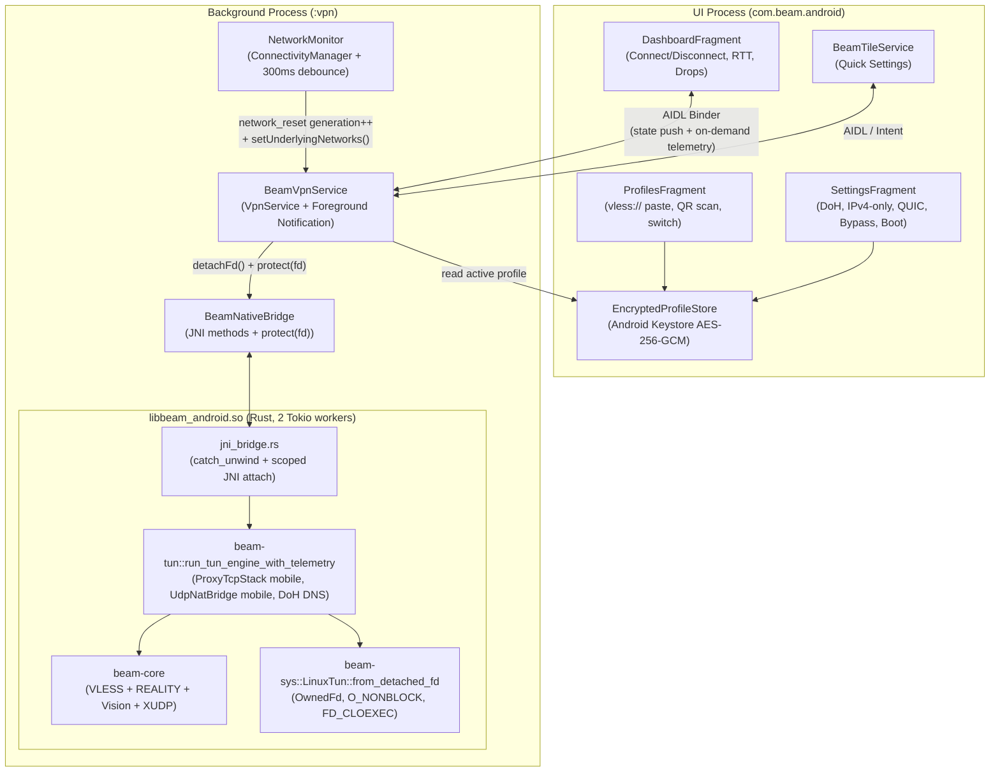
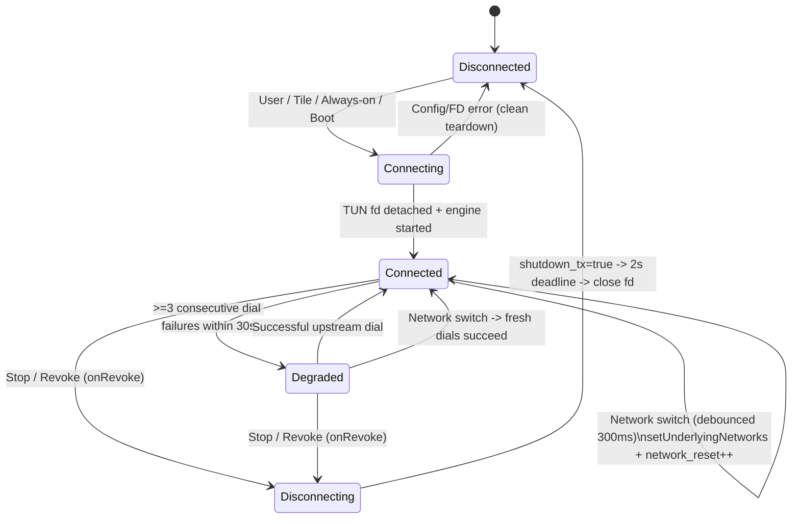

# Beam Android Client — Implementation Plan

This document is the single source of truth for the native **beam** Android
client (`crates/beam-android` + `clients/android`), superseding the earlier
`docs/ANDROID-PREP.md` preparation note.

## Goal & Product Decisions

Build a native, high-performance, low-battery, always-on Android VPN client for
`beam` modeled on the clean **sing-box for Android (SFA)** workflow
(Dashboard, Profiles, Settings, Quick Settings Tile, Always-on VPN), backed
directly by `beam-core`, `beam-tun`, and `beam-sys`.

| Area | Approved Decision |
|---|---|
| **FFI layer** | Thin JNI crate (`crates/beam-android`, `jni` crate). All FD `unsafe` stays in `crates/beam-sys`; only the narrow `#[unsafe(no_mangle)]` JNI entrypoints live in `crates/beam-android/src/jni_bridge.rs`. |
| **Process model** | Separate `:vpn` background process (`android:process=":vpn"`). Closing the UI frees the Android UI heap; `:vpn` retains only the native engine + minimal service. |
| **UI stack** | Pure Kotlin + XML + ViewBinding (Material 3) — minimal APK, fastest cold start, lowest RAM/battery. |
| **MVP scope** | Core SFA experience: Dashboard (Connect/Disconnect, status, RTT & drop/dial-failure summary), Profiles (`vless://` paste + QR scan, multi-profile switch), Settings, Quick Settings Tile (`TileService`). |
| **Target API & ABI** | `minSdk 31` (Android 12+), `targetSdk 35`, `arm64-v8a` (`aarch64-linux-android`). |
| **Split tunneling** | Phase 1: self-exclude (`addDisallowedApplication(packageName)`) + LAN/custom CIDR bypass (`excludeRoute` on API 33+, complement routes on API 31-32). Phase 2: user-selectable Per-App Proxy. |
| **DNS / IPv6 / QUIC** | Mobile profile defaults: IPv4-only (`reject_ipv6 = true`, `dns.ipv4_only = true`, capturing `::/0` in `VpnService.Builder` so IPv6 never leaks in clear), built-in `beam-tun` DoH (NextDNS / Cloudflare / custom URL), UDP/443 fast-reject (`reject_quic = true`). All configurable in Settings. |
| **Profile storage** | Android Keystore AES-256-GCM encrypted app-private storage, multi-profile support. |
| **Battery / RAM profile** | `TcpStackConfig::mobile()` (128 flows, 1800 s idle, ~48 MiB native ceiling), `UdpBridgeConfig::mobile()` (128 NAT sessions, 60 s idle), `tcp_relay_idle_timeout: None`, 2 Tokio workers, zero WakeLocks, zero idle timers, zero background UI/notification polling, Always-on VPN + Kill-switch + `BOOT_COMPLETED`. |
| **Build & test flow** | Both GitHub Actions CI (`.github/workflows/android-build.yml`) and local NDK/SDK setup (`scripts/android-setup-local.sh` + `scripts/android-build.sh`) for direct `adb` device testing/profiling. |

---

## Existing Rust Core Prep & `VpnService` Wiring Map

The Rust workspace already provides the mobile engine primitives:

| Android side | Rust core side | Status |
|---|---|---|
| `VpnService.Builder` TUN fd, after `detachFd()` | `beam_sys::LinuxTun::from_detached_fd` + `AndroidTun` (`TunDevice`) | Phase 1 |
| `VpnService.protect(fd)` on upstream TCP socket | `BeamClientConfig::socket_protector` | Ready in `beam-core` |
| `VpnService.protect(fd)` on local-DNS UDP socket | `DnsConfig::local_socket_protector` | Ready in `beam-tun` |
| `vless://` paste & QR import | `beam_core::client::parse_client_link` | Ready in `beam-core` |
| `ConnectivityManager` network switches | `TunEngineConfig::network_reset` | Ready in `beam-tun` |
| Lock-free UI & notification health | `EngineTelemetry`, `TelemetrySnapshot`, `run_tun_engine_with_telemetry` | Ready in `beam-tun` |

> **Critical invariant:** Wire `VpnService.protect(fd)` to **both**
> `BeamClientConfig::socket_protector` and `DnsConfig::local_socket_protector`.
> An unprotected upstream socket loops back into the TUN interface.

---

## Architecture

### Multi-Process & Native Layer

### Lifecycle & Network Switch State Machine

---

## Performance, Battery & Memory Design

1. **Zero idle wakeups:** `beam-tun` disarms its internal timer when no TCP
   flows or UDP datagrams are active. The app holds **zero `WakeLock`s**, runs
   **zero background heartbeat/URL-test timers**, and updates the foreground
   notification **only** on state transitions (zero updates while screen is off).
2. **No Go GC CPU micro-spikes:** Unlike Go-based clients (`sing-box`), Rust's
   `ProxyTcpStack` + `RelayBufPool` reuses packet/relay buffers deterministically
   with no garbage-collector pauses keeping the SoC out of deep sleep.
3. **Push-notification (FCM/MTalk) alignment:** `TcpStackConfig::mobile()`
   sets an 1800 s idle timeout with `tcp_relay_idle_timeout: None` (write
   deadlines stay bounded by `BeamClientConfig::idle_timeout`), plus upstream
   TCP keepalive (30 s idle, 10 s interval) and `TCP_USER_TIMEOUT` (30 s).
   Healthy 15-minute push sockets stay open without triggering costly cellular
   radio reconnect storms, while dead peers fail fast.
4. **Strict RAM ceiling:** 128 TCP flows × 128 KiB × 2 directions = 32 MiB ring
   buffer ceiling + ~16 MiB active relay scratch ≈ **48 MiB native ceiling**
   inside the isolated `:vpn` process, preventing Android LMK kills.
5. **Fast TUN & JNI hot paths:**
   - Tokio runtime capped at `worker_threads(2)`, `max_blocking_threads(4)`.
   - `AndroidTun` implements `try_recv_into()` for up to 128-packet RX batching.
   - `SocketProtector` uses scoped `JavaVM::attach_current_thread()` per
     upstream socket dial (`AttachGuard` detaches on return so repeated
     connect/disconnect cycles leak zero JNI thread peers while preserving
     zero `unsafe` in `beam-android`).
6. **Flap-resilient mobility:** `ConnectivityManager.registerDefaultNetworkCallback`
   debounces switches by 300 ms, updates `setUnderlyingNetworks()`, and
   increments `network_reset` so dead TCP flows receive immediate `RST` and
   XUDP mux / local DNS state reset cleanly.
7. **Congestion control boundary:** As recorded in [`clients/TODO.md`](../clients/TODO.md),
   stock rootless Android kernels expose only `cubic`/`reno` (no `tcp_bbr`).
   This client preserves the `TCP/443` REALITY cover and maximizes smoothness
   via TUN batching, RFC 7323 window scaling, and UDP/443 fast-reject without
   claiming BBR-class lossy upload performance on stock kernels.

---

## Component Breakdown

### 1. `crates/beam-sys`
- **`crates/beam-sys/src/tun.rs`**: Add `LinuxTun::from_detached_fd(raw_fd: RawFd, name: &str) -> io::Result<Self>` validating `raw_fd >= 0` and `name`, wrapping immediately in `OwnedFd`, and enforcing `O_NONBLOCK` + `FD_CLOEXEC` via `fcntl`. Add unit tests.

### 2. `crates/beam-android` (NEW)
- `Cargo.toml`: `crate-type = ["cdylib", "rlib"]`; `beam-core`, `beam-sys`, `beam-tun`, `tokio`, `jni = "0.21"`, `serde`, `serde_json`, `tracing`, `thiserror`; Android-only `android_logger`.
- `src/tun.rs`: `AndroidTun` (`AsyncFd<LinuxTun>` implementing `TunDevice` with `try_recv_into`).
- `src/config.rs`: JSON config DTO → `TunEngineConfig` (`TcpStackConfig::mobile()`, `UdpBridgeConfig::mobile()`, `tcp_relay_idle_timeout: None`, both `SocketProtector` hooks wired).
- `src/engine.rs`: `AndroidEngine` owning the 2-worker Tokio runtime, `shutdown_tx`, `network_reset_tx`, `EngineTelemetry`, and clean 2 s teardown.
- `src/jni_bridge.rs`: 5 thin `#[unsafe(no_mangle)]` JNI entrypoints wrapped in `catch_unwind`:
  - `nativeStart(tunFd, configJson, vpnService, stateCallback) -> handle`
  - `nativeStop(handle)`
  - `nativeNotifyNetworkChange(handle)`
  - `nativePollTelemetry(handle) -> json`
  - `nativeParseVlessLink(uri) -> json`

### 3. `clients/android/` (NEW)
- Gradle Kotlin DSL (`minSdk 31`, `targetSdk 35`, `arm64-v8a`, ViewBinding, Material 3, R8 release shrink).
- **IPC (`aidl/`):** `IBeamVpnService.aidl` and `IBeamStateCallback.aidl` (event-driven state push; `getTelemetry()` called every 2 s **only** while `DashboardFragment` is in `Lifecycle.State.STARTED`).
- **`:vpn` process:** `BeamVpnService.kt`, `NetworkMonitor.kt`, `VpnNotificationManager.kt`, `BootReceiver.kt`, `BeamNativeBridge.kt`.
  - `VpnService.Builder`: MTU 1500, `198.19.0.1/30` (outside the RFC 1918 and CGNAT bypass ranges), `0.0.0.0/0`, `fd00:be:a::1/126` + `::/0` (captured & fast-rejected by `reject_ipv6 = true` in IPv4-only mode to guarantee zero IPv6 leak), DNS `198.19.0.2`, `setMetered(false)`, `addDisallowedApplication(packageName)`, `excludeRoute` (API 33+) for LAN/custom bypass CIDRs, `setBlocking(false)`. Bypass CIDRs that overlap `198.19.0.0/30` are dropped so the TUN DNS server is never bypassed. On API 31-32, which has no `excludeRoute`, the same CIDRs are subtracted from `0.0.0.0/0` in pure Kotlin (`Ipv4RouteCalculator`) and the complement is added with `addRoute`.
- **UI process:** `MainActivity`, `DashboardFragment`, `ProfilesFragment`, `QrScannerActivity` (CameraX + ZXing), `SettingsFragment` (DoH presets, IPv4-only, QUIC reject, bypass CIDRs, Boot-on-start, Always-on VPN shortcut, Unrestricted Battery shortcut + Samsung One UI "Never sleeping apps" hint), `BeamTileService`.
- **Storage:** `EncryptedProfileStore.kt` using `AndroidKeyStore` (`AES/GCM/NoPadding`, 256-bit) with atomic temp-file + rename writes.

### 4. Build Tooling & CI
- `scripts/android-setup-local.sh`: installs `aarch64-linux-android` rustup target and guides/installs Android NDK r27c + SDK 35 + JDK 17.
- `scripts/android-build.sh`: cross-compiles `libbeam_android.so` (`--release`, stripped) with NDK `CC_aarch64_linux_android` (for `aws-lc-sys`), copies to `jniLibs/arm64-v8a/`, builds APK via Gradle, optional `--install` for `adb install -r`.
- `.github/workflows/android-build.yml`: runs `cargo test -p beam-android`, builds `libbeam_android.so`, runs `./gradlew testDebugUnitTest lintDebug assembleRelease`, uploads APK artifact.

---

## Phased Delivery Roadmap

1. **Phase 1 — Rust Core & JNI Foundation:** `beam-sys` detached FD + `crates/beam-android` + host unit tests + `make verify`.
2. **Phase 2 — Android `:vpn` Service, AIDL IPC & Local Build:** Gradle skeleton, `BeamVpnService`, `NetworkMonitor`, build scripts, first real-device tunnel test via `adb`.
3. **Phase 3 — SFA-Style UI, Keystore Storage, QR & Quick Settings Tile:** Multi-profile encrypted store, Dashboard, Profiles, QR scanner, Settings, `BeamTileService`, `BootReceiver`.
4. **Phase 4 — CI Workflow, Hardening & Field Profiling:** GitHub Actions APK workflow, Doze/battery/RAM/network-switch profiling on device, final docs.

---

## Verification Plan

### Automated
- `make verify` (workspace fmt, clippy, unit tests including `beam-sys` and `beam-android`).
- `./scripts/android-build.sh --debug` (cross-compile `aarch64-linux-android` + Gradle build).
- `cd clients/android && ./gradlew testDebugUnitTest lintDebug`.

### Real-Device (`adb`)
1. **Connectivity & leak test:** `vless://` paste & QR import, IPv4 egress check, DoH check, zero IPv6 leak check, UDP/443 fast-reject HTTP/2 fallback.
2. **Memory ceiling:** `adb shell dumpsys meminfo com.beam.android:vpn` (target ~20–30 MiB typical, ≤65 MiB peak; UI process reclaimed when swiped away).
3. **Doze & zero-wakeup battery:** `adb shell dumpsys batterystats --reset && adb shell dumpsys deviceidle force-idle` for 15–30 min → verify 0 timer wakeups and timely FCM push delivery.
4. **Network switch & kill-switch:** Wi-Fi ↔ 5G toggle (<2 s recovery via `network_reset`); Android *Always-on VPN* + *Block connections without VPN* across reboot.
